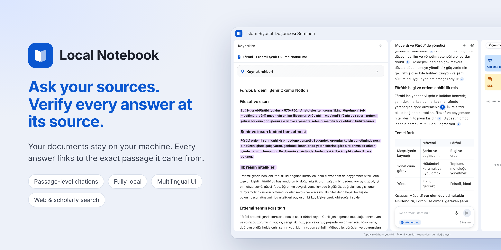
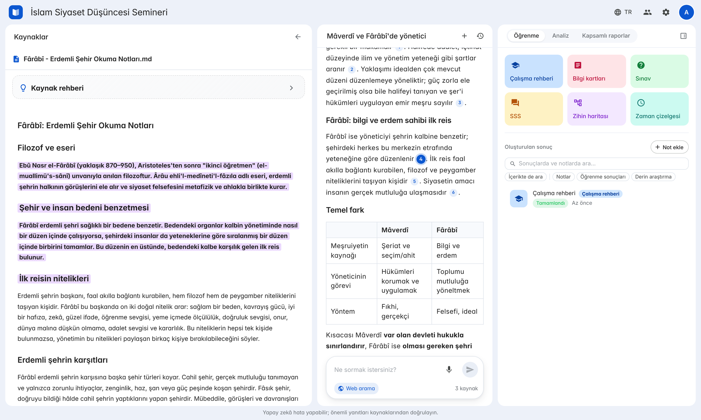
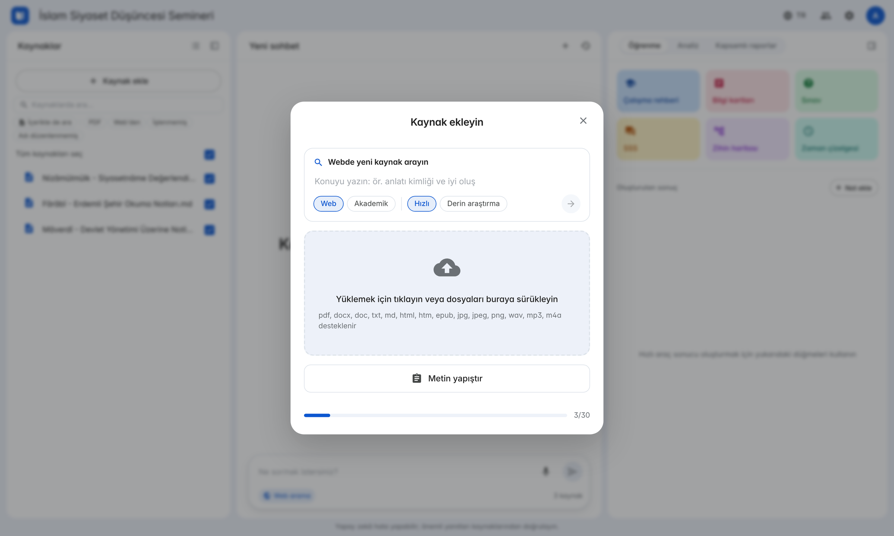
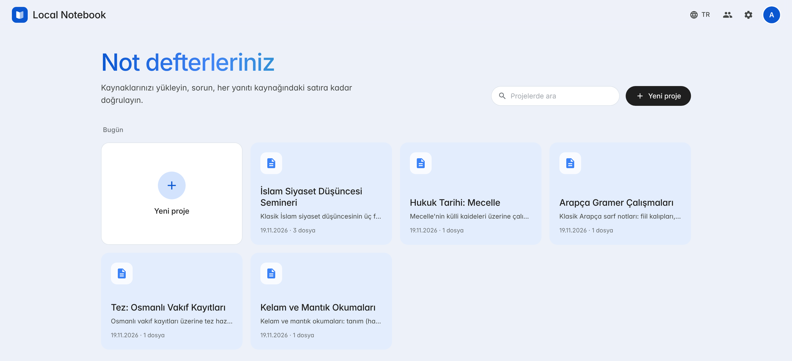
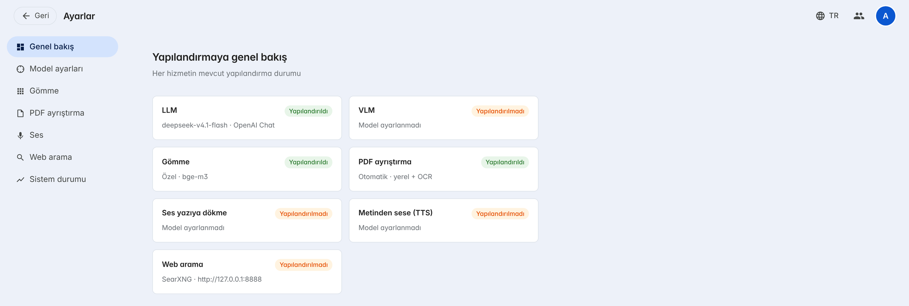
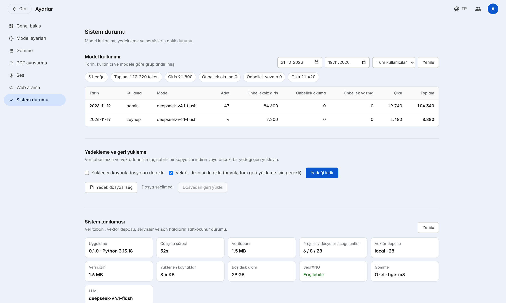
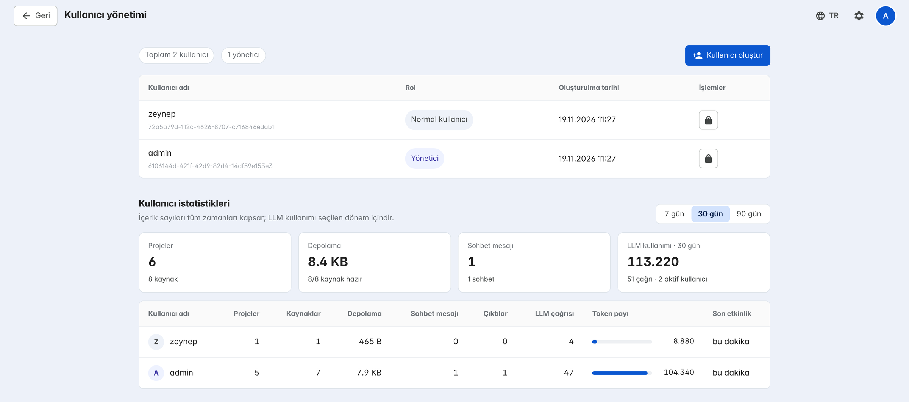

<p align="center">
  
</p>

<p align="center">
  <a href="README.md">Türkçe</a> · <b>English</b>
</p>

<p align="center">
  <a href="https://github.com/Mehmetbal2/local-notebook/releases/latest"></a>
  
  
  
  
</p>

# Local Notebook

**Local Notebook** is a research notebook that runs on your own computer, made for people who work with books, papers, lecture notes and archival documents. Upload your sources, ask questions, and every answer comes with citations that open the exact passage it came from. Your documents, database and vector index never leave your machine.

<p align="center">
  
</p>

The screenshots show the Turkish interface; English and Chinese are available from the language menu.

## Why Local Notebook?

- **Every claim is tied to its source.** Numbered citations open the source and highlight the passage; in PDFs they jump to the page and block, in audio to the timestamp.
- **Your data stays with you.** Backend, interface, SQLite database, vector store (Milvus Lite) and uploaded files all run locally. Use a cloud API or a local server such as Ollama or vLLM as the language model.
- **Built for long, multilingual documents.** Texts of hundreds of pages are chunked, summarized and indexed with the multilingual bge-m3 embedding model. Search ignores case, diacritics and vowel marks: "maverdi" finds "Mâverdî", and Arabic matches with or without harakat.
- **Multilingual interface.** Turkish, English and Chinese UI; the language of generated output can be set separately.

## Features

### Sources
- PDF, DOCX, DOC, TXT, MD, HTML, EPUB, images (JPG/PNG) and audio (WAV/MP3/M4A); paste text from the clipboard.
- Switch between the original PDF and the parsed text; optional OCR for scanned PDFs.
- Suggested "Author - Year - Title" names for sources.
- Search source titles, and optionally their content, then chat with just the sources you found.

### Web and scholarly search
- **Quick search:** results appear at once, tagged **Full text / Open access / Abstract only**. Chosen items become sources, as PDFs when a free copy exists (OpenAlex, Semantic Scholar).
- **Deep research:** the topic is split into sub-questions, 20–30 sources are read in full and a cited report is written (5–15 minutes, in the background).
- Search runs on a local [SearXNG](https://github.com/searxng/searxng) instance in Docker; no API key needed.

<p align="center">
  
</p>

### Chat and outputs
- Chat with the selected sources or with web search; stopped answers are kept. Chat titles are generated automatically.
- **Learning tools:** study guide, flashcards, quiz, FAQ, mind map, timeline.
- **Analysis tools:** content summary, briefing doc, podcast conversation, audio overview, comparative analysis, and custom quick tools with your own instructions.
- **Comprehensive reports:** long, sectioned, cited reports built by multi-step workflows.
- Search across notes, results and report sections; export chats and reports as Word documents.

### Administration
- Multiple users; the admin can create users, reset passwords and see **user statistics** (projects, sources, storage, messages, LLM usage).
- **Settings → System status:** model usage by date, user and model; one-click backup download and restore; live status of the database, vector store, services and recent errors.
- Safe defaults: a random admin password on first run, a persistent secret key, CORS limited to the local network.

<table>
  <tr>
    <td width="50%"></td>
    <td width="50%"></td>
  </tr>
  <tr>
    <td width="50%"></td>
    <td width="50%"></td>
  </tr>
</table>

## Installation

**Requirements:** Python 3.12+ (3.13 recommended), Node.js 20+, git. Docker (OrbStack or Docker Desktop on macOS) is optional and only needed for web search.

Download the source as a zip from the [latest release](https://github.com/Mehmetbal2/local-notebook/releases/latest), or clone it with git:

```bash
git clone https://github.com/Mehmetbal2/local-notebook.git
cd local-notebook

# Python environment and backend dependencies
python3 -m venv .venv
.venv/bin/pip install -r backend/requirements.txt

# Node.js: start.sh uses the project-local .node folder
mkdir -p .node/bin && ln -sf "$(command -v node)" .node/bin/node
(cd frontend && npm ci)

# First start (builds the interface)
./start.sh up -d --build
```

Then open **http://localhost:8080**. The admin password is generated on first start and written to `local-notebook-data/admin_password.txt`; delete the file after signing in.

On macOS you can also double-click in Finder:

| File | What it does |
|---|---|
| `Local-Notebook.command` | Starts the services, opens the browser and shows an actions menu |
| `Yeniden Başlat.command` | Restarts all services |

From the command line: `./start.sh up -d`, `./start.sh restart`, `./start.sh status`, `./start.sh logs -f`, `./start.sh down`.

## First configuration

In **Settings**:

1. **Model settings:** enter the address, model and API key of an OpenAI-compatible LLM provider (OpenAI, DeepSeek, Anthropic, or a local Ollama/vLLM). Optionally add a VLM for image analysis.
2. **Embedding:** the default local service uses [BAAI/bge-m3](https://huggingface.co/BAAI/bge-m3) from `local-notebook-data/models/bge-m3` and is started by the app automatically. It needs the packages in `services/embedding/requirements.txt`. You can choose an OpenAI-compatible embedding API instead.
3. **PDF parsing, Audio, Web search:** OCR, speech-to-text (FunASR) and text-to-speech (TTS) are optional.

When you change the embedding model, vectors are rebuilt with the new model in the background; texts and summaries are kept.

## Data

Everything lives in `LOCAL_NOTEBOOK_DATA_DIR` (default `./local-notebook-data/`):

```text
local-notebook-data/
├── local_notebook.db      # SQLite (WAL): users, projects, chats, settings
├── milvus.db/             # Milvus Lite vector store
├── uploads/               # uploaded sources
├── models/                # local models (e.g. bge-m3)
├── backups/               # safety copies made before a restore
└── logs/                  # service logs
```

Use **Settings → System status → Backup and restore** for backups. Details: [docs/OPERATIONS.md](docs/OPERATIONS.md).

> [!IMPORTANT]
> LLM API keys are stored in plain text in the SQLite database; do not share the data folder. Do not place it in a synced folder such as iCloud Drive, OneDrive or a network drive; SQLite WAL files can be corrupted.

## Architecture

| Layer | Technology |
|---|---|
| Interface | Vue 3, TypeScript, Vite ([frontend/](frontend)) |
| Backend | FastAPI, SQLAlchemy, embedded task queue, agent-based chat ([backend/](backend)) |
| Storage | SQLite (WAL), Milvus Lite; a Milvus server for large installations |
| Local services | bge-m3 embedding, FunASR, SearXNG ([services/](services)) |

Operations, security defaults, environment variables and troubleshooting: [docs/OPERATIONS.md](docs/OPERATIONS.md).

A detailed Turkish guide to every feature, the internal pipelines, limits and requirements (with diagrams): [docs/KILAVUZ.md](docs/KILAVUZ.md).

## Development

```bash
# Backend tests
cd backend && ../.venv/bin/python -m unittest discover -s tests

# Interface: type check and build
cd frontend && npx vue-tsc -b && npx vite build
```

GitHub Actions runs the tests on every push and pull request.

## Releases

Changes are listed in [CHANGELOG.md](CHANGELOG.md) (Turkish); downloadable versions are on the [Releases](https://github.com/Mehmetbal2/local-notebook/releases) page.

## License

[Apache License 2.0](LICENSE). Local Notebook is based on [chatboxai/local-notebook](https://github.com/chatboxai/local-notebook); see [NOTICE](NOTICE).
