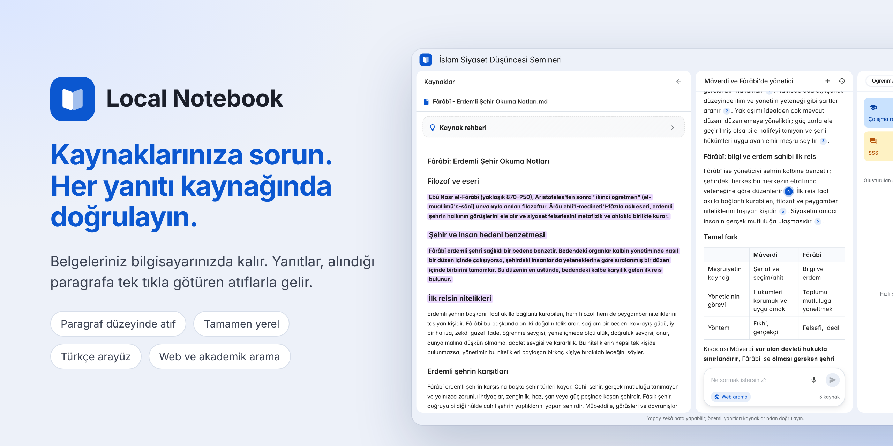
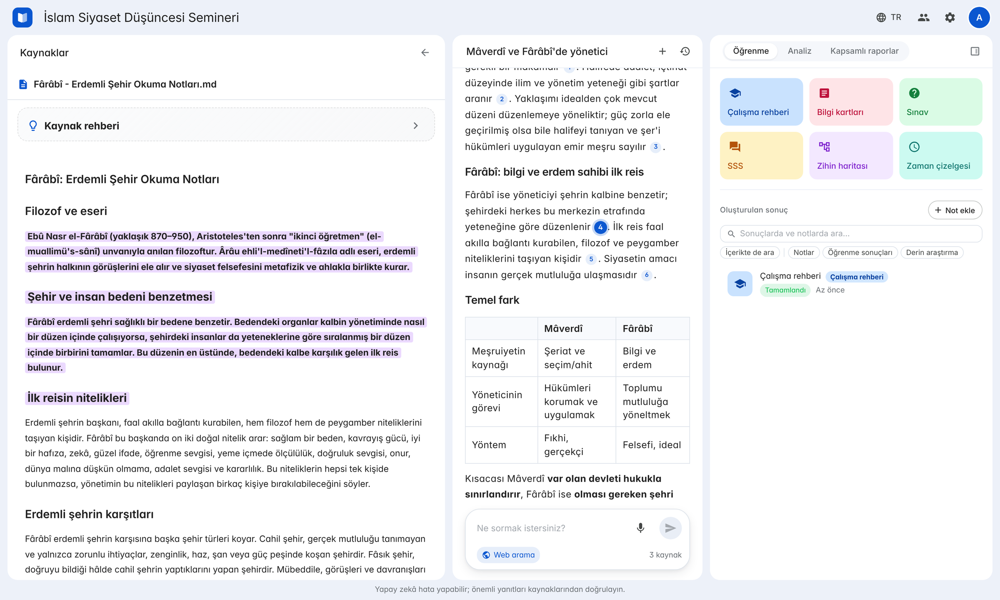
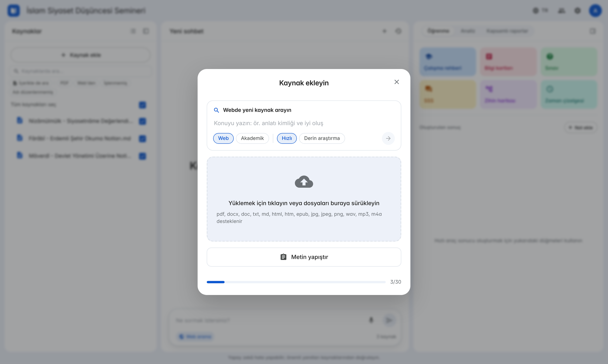
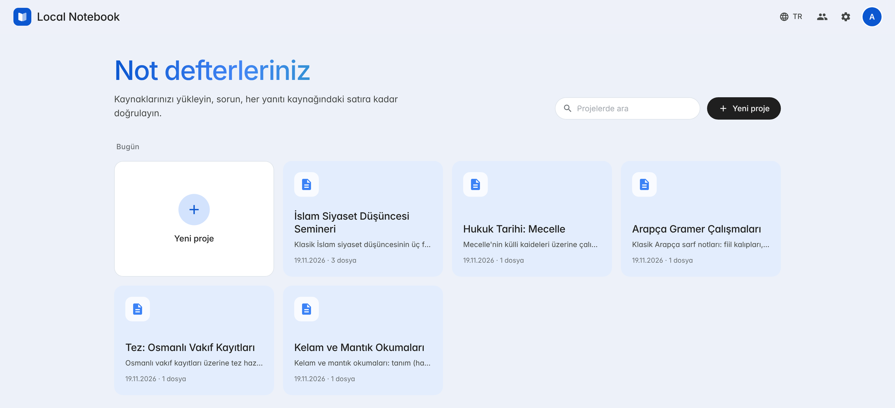
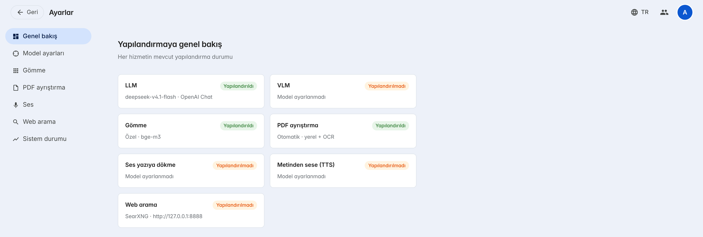
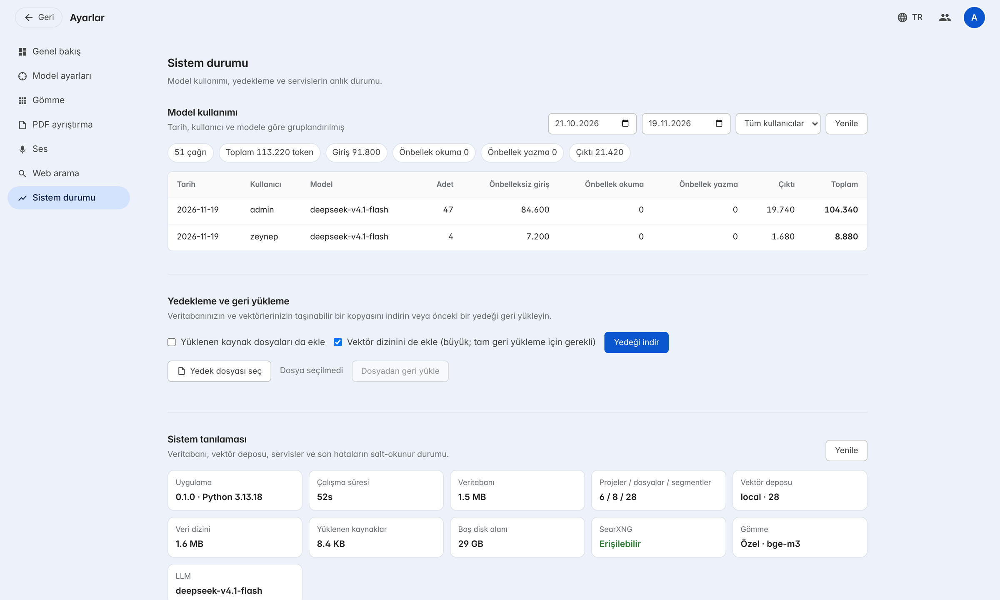
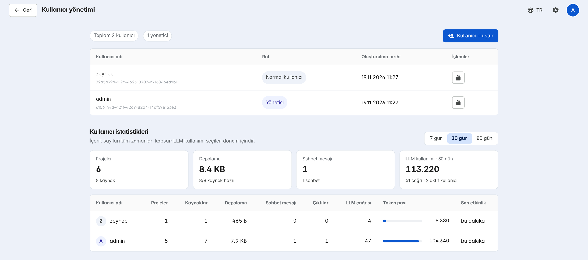

<p align="center">
  
</p>

<p align="center">
  <b>Türkçe</b> · <a href="README.en.md">English</a>
</p>

<p align="center">
  <a href="https://github.com/Mehmetbal2/local-notebook/releases/latest"></a>
  
  
  
  
</p>

# Local Notebook

**Local Notebook**, kitap, makale, ders notu ve arşiv belgeleriyle çalışanlar için bilgisayarınızda çalışan bir araştırma not defteridir. Kaynaklarınızı yüklersiniz, onlara soru sorarsınız; her yanıt, alındığı paragrafa tek tıkla götüren atıflarla gelir. Belgeleriniz, veritabanınız ve vektör indeksiniz kendi makinenizde kalır.

<p align="center">
  
</p>

## Neden Local Notebook?

- **Her iddia kaynağına bağlı.** Yanıtlardaki numaralı atıflar kaynağı açar ve ilgili paragrafı vurgular; PDF'lerde sayfa ve blok konumuna, ses kayıtlarında zaman damgasına gider.
- **Verileriniz sizde.** Arka uç, arayüz, SQLite veritabanı, vektör deposu (Milvus Lite) ve yüklenen dosyalar bilgisayarınızda çalışır. Dil modeli olarak bulut API'si ya da Ollama, vLLM gibi yerel bir sunucu kullanabilirsiniz.
- **Uzun ve çok dilli belgeler için.** Yüzlerce sayfalık metinler parçalanır, özetlenir ve çok dilli bge-m3 gömme modeliyle indekslenir. Aramalar büyük-küçük harf, aksan ve harekeden bağımsızdır: "maverdi" yazınca "Mâverdî" bulunur, Arapça metinler harekeli ya da harekesiz eşleşir.
- **Türkçe arayüz.** Arayüz Türkçe, İngilizce ve Çince kullanılabilir; çıktıların dili ayrıca seçilebilir.

## Özellikler

### Kaynaklar
- PDF, DOCX, DOC, TXT, MD, HTML, EPUB, görsel (JPG/PNG) ve ses (WAV/MP3/M4A) dosyaları; panodan metin yapıştırma.
- PDF'ler için özgün görünüm ile ayrıştırılmış metin arasında geçiş, tarama PDF'ler için isteğe bağlı OCR.
- Kaynak adlarını "Yazar - Yıl - Eser" biçiminde düzenleme önerisi.
- Kaynak panelinde başlıkta ve isteğe bağlı olarak içerikte arama; bulunanlarla sohbet etme.

### Web ve akademik arama
- **Hızlı arama:** Sonuçlar hemen gelir ve **Tam metin / Açık erişim / Yalnızca özet** olarak işaretlenir. Seçtikleriniz kaynak olarak eklenir; ücretsiz bir PDF varsa (OpenAlex, Semantic Scholar) PDF olarak gelir.
- **Derin araştırma:** Konu alt sorulara bölünür, 20–30 kaynak baştan sona okunur ve atıflı bir rapor yazılır (5–15 dakika, arka planda).
- Arama, Docker'da çalışan yerel bir [SearXNG](https://github.com/searxng/searxng) üzerinden yapılır; API anahtarı gerekmez.

<p align="center">
  
</p>

### Sohbet ve çıktılar
- Seçili kaynaklarla veya web aramasıyla sohbet; durdurulan yanıtlar da kaydedilir. Sohbet başlıkları otomatik üretilir.
- **Öğrenme araçları:** çalışma rehberi, bilgi kartları, sınav, sık sorulan sorular, zihin haritası, zaman çizelgesi.
- **Analiz araçları:** içerik özeti, brifing belgesi, podcast sohbeti, sesli genel bakış, karşılaştırmalı analiz, kendi talimatınızla özel hızlı araç.
- **Kapsamlı raporlar:** çok adımlı iş akışlarıyla uzun, bölümlü ve atıflı raporlar.
- Notlar, sonuçlar ve rapor bölümleri arasında arama; sohbetleri ve raporları Word belgesi olarak dışa aktarma.

### Yönetim
- Çok kullanıcılı kullanım; yönetici için kullanıcı oluşturma, şifre sıfırlama ve **kullanıcı istatistikleri** (proje, kaynak, depolama, mesaj, LLM kullanımı).
- **Ayarlar → Sistem durumu:** tarih, kullanıcı ve modele göre model kullanımı; tek tıkla yedek indirme ve geri yükleme; veritabanı, vektör deposu, servisler ve son hataların anlık durumu.
- Güvenli varsayılanlar: ilk kurulumda rastgele yönetici şifresi, kalıcı gizli anahtar, yalnızca yerel ağa açık CORS.

<table>
  <tr>
    <td width="50%"></td>
    <td width="50%"></td>
  </tr>
  <tr>
    <td width="50%"></td>
    <td width="50%"></td>
  </tr>
</table>

## Kurulum

**Gerekenler:** Python 3.12+ (3.13 önerilir), Node.js 20+, git. Web araması için isteğe bağlı olarak Docker (macOS'ta OrbStack veya Docker Desktop).

Kaynak kodu [son sürüm sayfasından](https://github.com/Mehmetbal2/local-notebook/releases/latest) zip olarak indirebilir ya da git ile alabilirsiniz:

```bash
git clone https://github.com/Mehmetbal2/local-notebook.git
cd local-notebook

# Python ortamı ve arka uç bağımlılıkları
python3 -m venv .venv
.venv/bin/pip install -r backend/requirements.txt

# Node.js: start.sh proje içindeki .node klasörünü kullanır
mkdir -p .node/bin && ln -sf "$(command -v node)" .node/bin/node
(cd frontend && npm ci)

# İlk başlatma (arayüz derlenir)
./start.sh up -d --build
```

Ardından tarayıcıda **http://localhost:8080** adresini açın. Yönetici şifresi ilk açılışta oluşturulur ve `local-notebook-data/admin_password.txt` dosyasına yazılır; giriş yaptıktan sonra bu dosyayı silin.

macOS'ta Finder'dan çift tıklayarak da kullanabilirsiniz:

| Dosya | Ne yapar |
|---|---|
| `Local-Notebook.command` | Servisleri başlatır, tarayıcıyı açar ve bir işlem menüsü gösterir |
| `Yeniden Başlat.command` | Tüm servisleri yeniden başlatır |

Komut satırından: `./start.sh up -d` (başlat), `./start.sh restart`, `./start.sh status`, `./start.sh logs -f`, `./start.sh down` (durdur).

## İlk yapılandırma

**Ayarlar** sayfasından:

1. **Model ayarları:** OpenAI uyumlu bir LLM sağlayıcısının adresini, modelini ve API anahtarını girin (OpenAI, DeepSeek, Anthropic veya yerel Ollama/vLLM). Görsel analiz için isteğe bağlı bir VLM ekleyebilirsiniz.
2. **Gömme:** Varsayılan yerel servis, `local-notebook-data/models/bge-m3` klasöründeki [BAAI/bge-m3](https://huggingface.co/BAAI/bge-m3) modelini kullanır ve uygulama tarafından otomatik başlatılır. Yerel servis için `services/embedding/requirements.txt` bağımlılıkları gerekir. Bunun yerine OpenAI uyumlu bir gömme API'si de seçebilirsiniz.
3. **PDF ayrıştırma, Ses, Web arama:** OCR, konuşmayı yazıya dökme (FunASR) ve seslendirme (TTS) isteğe bağlıdır.

Gömme modelini değiştirdiğinizde vektörler arka planda yeni modelle yeniden oluşturulur; metinler ve özetler korunur.

## Veriler

Tüm veriler `LOCAL_NOTEBOOK_DATA_DIR` klasöründe durur (varsayılan `./local-notebook-data/`):

```text
local-notebook-data/
├── local_notebook.db      # SQLite (WAL): kullanıcılar, projeler, sohbetler, ayarlar
├── milvus.db/             # Milvus Lite vektör deposu
├── uploads/               # yüklenen kaynaklar
├── models/                # yerel modeller (ör. bge-m3)
├── backups/               # geri yükleme öncesi güvenlik kopyaları
└── logs/                  # servis günlükleri
```

Yedek almak için **Ayarlar → Sistem durumu → Yedekleme ve geri yükleme** bölümünü kullanın. Ayrıntılar: [docs/OPERATIONS.md](docs/OPERATIONS.md).

> [!IMPORTANT]
> LLM API anahtarları SQLite veritabanında düz metin olarak saklanır; veri klasörünü paylaşmayın. Veri klasörünü iCloud Drive, OneDrive veya ağ diski gibi eşitlenen bir konuma koymayın; SQLite WAL dosyaları bozulabilir.

## Mimari

| Katman | Teknoloji |
|---|---|
| Arayüz | Vue 3, TypeScript, Vite ([frontend/](frontend)) |
| Arka uç | FastAPI, SQLAlchemy, gömülü görev kuyruğu, ajan tabanlı sohbet ([backend/](backend)) |
| Depolama | SQLite (WAL), Milvus Lite; büyük kurulumlar için Milvus sunucusu |
| Yerel servisler | bge-m3 gömme, FunASR, SearXNG ([services/](services)) |

İşletim, güvenlik varsayılanları, ortam değişkenleri ve sorun giderme için [docs/OPERATIONS.md](docs/OPERATIONS.md) belgesine bakın.

## Geliştirme

```bash
# Arka uç testleri
cd backend && ../.venv/bin/python -m unittest discover -s tests

# Arayüz: tip denetimi ve derleme
cd frontend && npx vue-tsc -b && npx vite build
```

Her push ve pull request'te testler GitHub Actions ile çalışır.

## Sürümler

Değişiklikler [CHANGELOG.md](CHANGELOG.md) dosyasında, indirilebilir sürümler [Releases](https://github.com/Mehmetbal2/local-notebook/releases) sayfasındadır.

## Lisans

[Apache License 2.0](LICENSE). Local Notebook, [chatboxai/local-notebook](https://github.com/chatboxai/local-notebook) projesi temel alınarak geliştirilmiştir; ayrıntılar [NOTICE](NOTICE) dosyasındadır.
