# Local Notebook — Çalışma Kılavuzu

Bu kılavuz Local Notebook'un nasıl çalıştığını anlatır: bir belgeyi yüklediğiniz andan bir soruya atıflı yanıt aldığınız ana kadar her adımı, bu adımların kurallarını ve sınırlarını, bir şey ters gittiğinde ne olduğunu. Kullanım ipuçlarından çok "perde arkasını" anlatır; kurulum için [README](../README.md), işletim ve ortam değişkenleri için [OPERATIONS](OPERATIONS.md) belgesine bakın.

Kılavuzdaki sayılar uygulamanın **v1.0.0** sürümündeki varsayılan değerlerdir. Değiştirilebilenlerin ortam değişkeni adı yanında verilmiştir.

## İçindekiler

1. [Büyük resim](#1-büyük-resim)
2. [Çalıştırma ve bileşenler](#2-çalıştırma-ve-bileşenler)
3. [Veriler nerede ve nasıl tutulur](#3-veriler-nerede-ve-nasıl-tutulur)
4. [Kaynak işleme hattı](#4-kaynak-işleme-hattı)
5. [Parçalar, özetler ve dosya özeti](#5-parçalar-özetler-ve-dosya-özeti)
6. [Vektörler ve anlamsal arama](#6-vektörler-ve-anlamsal-arama)
7. [Sohbet: bir yanıt nasıl üretilir](#7-sohbet-bir-yanıt-nasıl-üretilir)
8. [Atıflar: yanıttan paragrafa](#8-atıflar-yanıttan-paragrafa)
9. [Hızlı araçlar, kapsamlı raporlar ve derin araştırma](#9-hızlı-araçlar-kapsamlı-raporlar-ve-derin-araştırma)
10. [Web ve akademik arama](#10-web-ve-akademik-arama)
11. [Metin arama ve kaynak adlandırma](#11-metin-arama-ve-kaynak-adlandırma)
12. [Ayarlar ve modeller](#12-ayarlar-ve-modeller)
13. [Kullanıcılar, güvenlik ve yönetim](#13-kullanıcılar-güvenlik-ve-yönetim)
14. [Hatalar, yeniden denemeler ve kurtarma](#14-hatalar-yeniden-denemeler-ve-kurtarma)
15. [Bilinen sınırlar](#15-bilinen-sınırlar)
16. [Sözlük](#16-sözlük)

---

## 1. Büyük resim

Local Notebook üç işi birbirine bağlar: **kaynakları anlamak**, **soruya uygun yerleri bulmak** ve **bulunan yerlere dayanarak yazmak**.

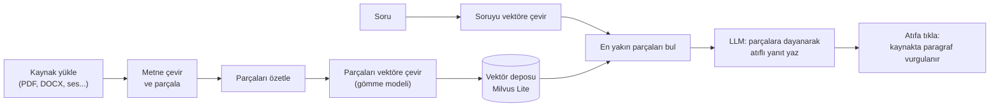

Bu düzene **RAG** (Retrieval-Augmented Generation, erişimle desteklenen üretim) denir. Dil modeli yanıtı kendi bilgisinden değil, o an kaynaklarınızdan getirilen parçalardan yazar ve her iddianın hangi parçaya dayandığını işaretler.

<p align="center">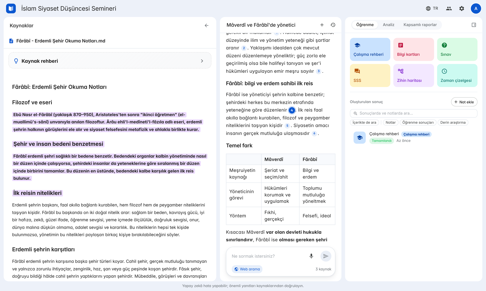</p>

Çalışma alanı üç panelden oluşur: solda **kaynaklar** (ve açılan kaynağın önizlemesi), ortada **sohbet**, sağda **araçlar ve sonuçlar** (hızlı araçlar, kapsamlı raporlar, notlar).

---

## 2. Çalıştırma ve bileşenler

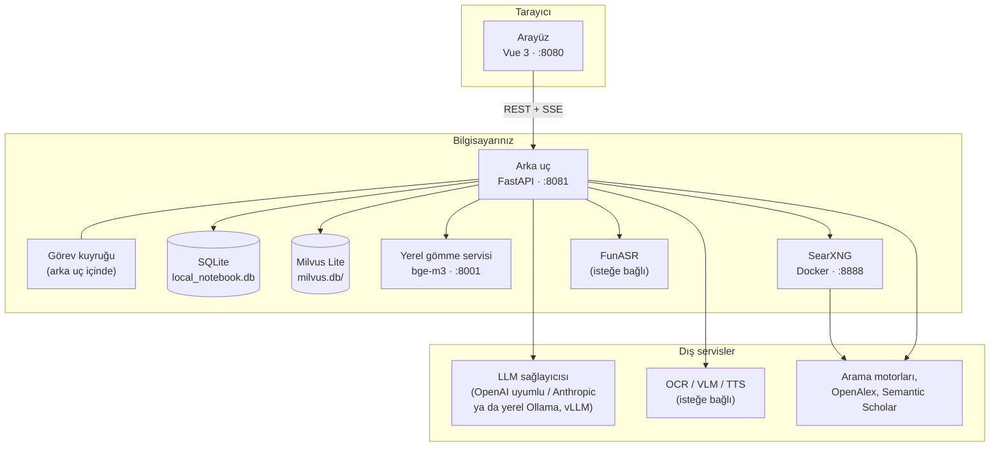

| Bileşen | Görev | Varsayılan |
|---|---|---|
| Arayüz | Vite ile çalışan Vue 3 uygulaması | `FRONTEND_PORT=8080` |
| Arka uç | API, sohbet akışı (SSE), arka plan görevleri | `BACKEND_PORT=8081` |
| Görev kuyruğu | Ayrıştırma, vektörleme, araçlar ve raporlar; arka uç sürecinin içinde çalışır, Redis gerekmez | Aynı anda 4 iş (`WORKER_MAX_JOBS`), iş başına en çok 1 saat (`WORKER_JOB_TIMEOUT`) |
| SQLite | Kullanıcılar, projeler, parçalar, sohbetler, ayarlar | WAL kipi |
| Milvus Lite | Parça ve görsel vektörleri | `milvus.db/` klasörü |
| Yerel gömme servisi | bge-m3 modelini çalıştırır; arka uç gerektiğinde kendisi başlatır | `:8001` ya da Ayarlar'daki adresin portu |
| SearXNG | Web ve akademik arama; Docker'da çalışır | `SEARXNG_PORT=8888` |

`start.sh` bu parçaları sırayla başlatır, durumlarını gösterir ve durdurur (`up`, `down`, `restart`, `status`, `logs`). Yerel gömme servisini, Ayarlar'da kayıtlı yerel adresin portunda başlatır; böylece arka uç ile servis aynı portu kullanır.

**Açılışta arka uç sırasıyla şunları yapar:**

1. Bekleyen bir geri yükleme varsa uygular (önce mevcut verinin güvenlik kopyasını alır).
2. Eski yedek artıklarını temizler (bkz. [13](#13-kullanıcılar-güvenlik-ve-yönetim)).
3. Veritabanını hazırlar, ilk açılışta rastgele bir yönetici şifresi ve kalıcı bir gizli anahtar üretir.
4. Görev kuyruğunu başlatır ve yarıda kalmış işleri ("işleniyor" durumunda takılı dosyalar) yeniden kuyruğa alır.

---

## 3. Veriler nerede ve nasıl tutulur

Her şey `LOCAL_NOTEBOOK_DATA_DIR` klasöründedir (varsayılan `./local-notebook-data/`).

```text
local-notebook-data/
├── local_notebook.db (+ -wal, -shm)   SQLite: bütün kayıtlar ve ayarlar
├── milvus.db/                          vektör deposu
├── uploads/                            yüklenen özgün dosyalar
├── models/bge-m3/                      yerel gömme modeli
├── backups/                            geri yükleme öncesi güvenlik kopyaları
├── restore/                            uygulanmayı bekleyen geri yükleme
├── logs/  run/                         günlükler, çalışan servislerin port/pid dosyaları
├── admin_password.txt                  ilk yönetici şifresi (girişten sonra silin)
└── secret_key                          oturum anahtarlarını imzalayan gizli anahtar
```

**Veritabanındaki ana kayıtlar:**

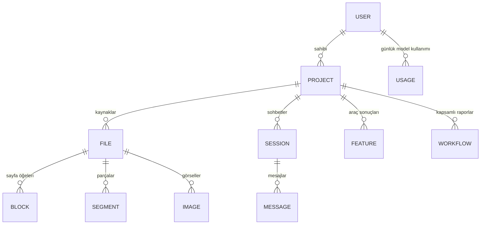

| Kayıt | İçerik |
|---|---|
| **Blok** | Belgenin en küçük öğesi: bir paragraf, başlık, tablo ya da görsel; PDF'lerde sayfa numarası ve konumu (bbox) ile |
| **Parça (segment)** | Bloklardan oluşturulan, 200–400 karakterlik arama birimi; hangi bloklardan oluştuğunu bilir |
| **Görsel** | Belgedeki ya da yüklenen görsel ve modelin yazdığı açıklaması |
| **Özellik (feature)** | Hızlı araç ve derin araştırma sonuçları |
| **İş akışı (workflow)** | Kapsamlı raporlar ve bölümleri |
| **Kullanım** | Gün × kullanıcı × model başına çağrı ve token sayıları |

Vektörler veritabanında değil Milvus'ta durur; ikisi parça kimliğiyle (segment_id) birbirine bağlıdır.

---

## 4. Kaynak işleme hattı

Bir dosya yüklendiğinde arka planda `parse_file_task` görevi çalışır. Arayüz durumu periyodik olarak sorar ve ilerlemeyi gösterir.

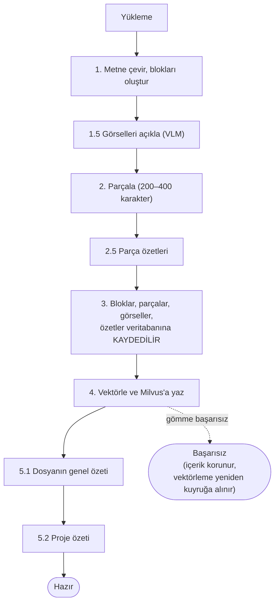

### 4.1 Biçimlere göre ayrıştırma

| Biçim | Nasıl okunur |
|---|---|
| PDF | **Otomatik** kipte metin katmanı olan PDF'ler yerelde (PyMuPDF) okunur; taranmış PDF'ler, OCR servisi tanımlıysa OCR'a gider. Yerel okuma başarısız olursa OCR'a düşer. Kip Ayarlar'dan **Yerel** ya da **OCR** olarak sabitlenebilir. PDF içindeki görseller ayrıca çıkarılır. |
| DOCX, DOC | Paragraflar ve başlıklar bloklara çevrilir |
| TXT, MD | Düz metin; Markdown başlıkları korunur |
| HTML | Metin içeriği; tarayıcıda çalıştırılmaz, düz metin olarak saklanır |
| EPUB | Bölümler sırayla okunur |
| JPG, PNG | Görsel modeli (VLM) bir açıklama yazar; açıklama aranabilir metin olur |
| WAV, MP3, M4A | FunASR yazıya döker; parçalar zaman damgalarını taşır, atıf ilgili saniyeye gider |

### 4.2 Durumlar

| Durum | Anlamı |
|---|---|
| Bekliyor | Kuyrukta |
| İşleniyor | Görev çalışıyor; ilerleme yüzdesi ve adım mesajı görünür |
| Hazır | Parçalar, özetler ve vektörler tamam; sohbette kullanılabilir |
| Başarısız | Bir adım hata verdi; hata mesajı gösterilir |
| İptal edildi | Kullanıcı durdurdu |

**İçerik önce kaydedilir.** Adım 3'te parçalar ve özetler veritabanına yazılır, vektörleme bundan sonra gelir. Böylece gömme servisi hata verirse emek kaybolmaz: kaynak "Başarısız" olur, yalnızca vektörleri yeniden oluşturan görev (`reembed_file_task`) kendiliğinden kuyruğa alınır ve LLM özetleri bir daha üretilmez, bir daha ücret ödenmez.

---

## 5. Parçalar, özetler ve dosya özeti

### 5.1 Parçalama

Bloklar art arda eklenerek parçalar oluşturulur:

| Kural | Değer |
|---|---|
| En kısa parça | 200 karakter |
| Hedef en uzun parça | 400 karakter |
| Kesin sınır | 480 karakter (400 × 1,2) |
| Örtüşme | Bir önceki parçanın son 50 karakteri sonrakinin başına eklenir |

Örtüşme, bir cümlenin iki parçanın sınırında bölünüp anlamını yitirmesini önler. Her parça hangi bloklardan oluştuğunu bilir; atıflar bu bağ sayesinde sayfadaki doğru yere gider.

### 5.2 Parça özetleri

Her parçanın bir "özeti" vardır; arama sonuçlarında modele önce bu özetler gösterilir. Ancak **her parçaya LLM özeti yazılmaz**:

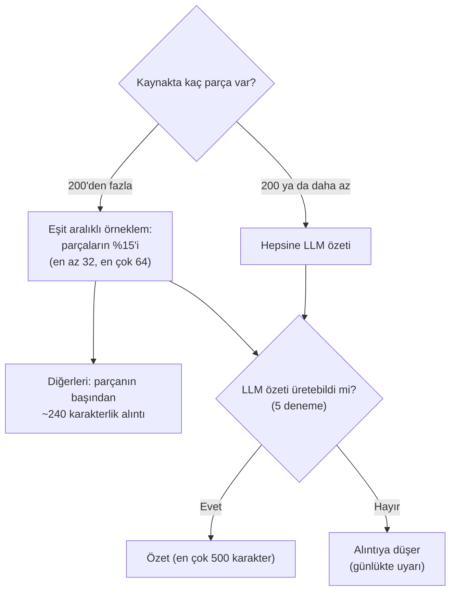

| Ayar | Varsayılan | Ortam değişkeni |
|---|---|---|
| Tamamı özetlenecek en büyük kaynak | 200 parça | `SEGMENT_SUMMARY_FULL_LIMIT` |
| Örneklem oranı / en az / en çok | %15 / 32 / 64 | `SEGMENT_SUMMARY_SAMPLE_RATIO`, `_MIN`, `_MAX` |
| Alıntı uzunluğu | 240 karakter | `SEGMENT_SUMMARY_SNIPPET_CHARS` |
| Deneme sayısı | 5 | `SEGMENT_SUMMARY_MAX_ATTEMPTS` |
| Aynı anda özet isteği | 2 | `SEGMENT_SUMMARY_CONCURRENCY` |
| Bütün uygulamada aynı anda LLM isteği | 2 | `LLM_MAX_CONCURRENCY` |

Alıntı cümle sonunda, olmazsa kelime sonunda kesilir. LLM'e her parçanın en çok ilk 2.000 karakteri gönderilir (parçalar zaten bundan kısadır). Özet, seçili **çıktı dilinde** yazılır.

> [!NOTE]
> Alıntıyla kalan ya da özeti başarısız olan parçalar **aramada dezavantajlı değildir**: vektörler özetten değil parçanın tam metninden üretilir (bkz. [6](#6-vektörler-ve-anlamsal-arama)). Özetin kalitesi yalnızca modelin arama sonucunda ilk gördüğü metni etkiler; model gerekirse tam metni ayrıca okur (bkz. [7](#7-sohbet-bir-yanıt-nasıl-üretilir)). Eksik parça özetleri sonradan yeniden üretilmez.

### 5.3 Dosyanın genel özeti ve proje özeti

Dosyanın genel özeti **tam metinden değil, parça özetlerinden** çıkarılır:

1. Belgeye eşit aralıklarla yayılmış **20 parça özeti** seçilir; önce LLM özeti için ayrılmış parçalar, 20'ye ulaşmazsa diğerleri (alıntılar) kullanılır.
2. LLM bunlardan bir genel özet ve en çok **10 anahtar kelime** yazar (JSON yanıt).
3. Yanıt geçersizse hatayı belirten bir istemle en çok **3 kez** denenir.
4. Yine olmazsa yedek kullanılır: modelin düz metin yanıtı ya da seçilen 20 özetin 500 karakterde kesilmiş birleşimi (anahtar kelimesiz).
5. Özet tamamen boş kalırsa, kaynak yeniden vektörlendiğinde kayıtlı parça özetlerinden yeniden üretilir.

**Proje özeti** aynı yöntemle dosyaların genel özetlerinden çıkarılır; ana sayfadaki not defteri kartlarında görünür. Bir kaynak eklenince ya da silinince yeniden üretilir.

---

## 6. Vektörler ve anlamsal arama

### 6.1 Gömme (embedding)

Gömme modeli bir metni, anlamını temsil eden sayılardan oluşan bir **vektöre** çevirir. Anlamca yakın metinlerin vektörleri birbirine yakın düşer; "halifenin şartları" sorusu, içinde bu kelimeler geçmese de "imamda aranan nitelikler" paragrafını bulabilir.

| Kural | Değer |
|---|---|
| Ne vektörlenir | Parçanın **özgün metni** (özet değil); görsellerde modelin yazdığı açıklama |
| Ön işlem | Arapça metinlerde hareke, tatvil kaldırılır; elif çeşitleri ve ى birleştirilir |
| Gruplama | Parçalar gruplar hâlinde gönderilir |
| Yerel model | **BAAI/bge-m3**, 1024 boyut, çok dilli; vektörler birim uzunluğa normalize edilir |
| Alternatif | OpenAI uyumlu herhangi bir gömme API'si (ör. qwen3-embedding) |

### 6.2 Vektör deposu

Bütün projeler iki ortak koleksiyonu paylaşır: **metin parçaları** ve **görseller**. Her kayıt proje ve dosya kimliğini taşır; arama bu alanlarla süzülür.

| Kural | Değer |
|---|---|
| Uzaklık ölçüsü | **L2 (Öklid)**. Normalize vektörlerde kosinüs benzerliğiyle aynı sıralamayı verir |
| İndeks | Yerelde **IVF_FLAT**, 128 küme (Milvus sunucusunda IVF_PQ) |
| Aramada taranan küme | 32 (yaklaşık arama; tam taramaya çok yakın sonuç) |
| Boyut koruması | Koleksiyonun vektör boyutu ile sorgunun boyutu farklıysa arama açık bir hatayla durur |

### 6.3 Gömme modelini değiştirmek

Farklı modellerin vektörleri birbiriyle karşılaştırılamaz. Bu yüzden model değiştiğinde:

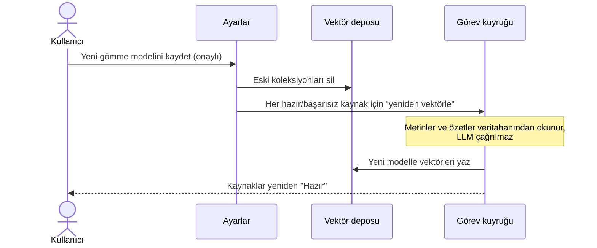

Ayarlar'daki **Belgeleri Yeniden Vektörleştir** düğmesi aynı işlemi elle başlatır.

---

## 7. Sohbet: bir yanıt nasıl üretilir

Sohbet, araç kullanabilen bir **ajan** tarafından yürütülür. Ajan bir dil modelidir; yanıt yazmadan önce kaynaklarda arama yapmak, parça okumak, görsellere soru sormak gibi araçları kendisi çağırır.

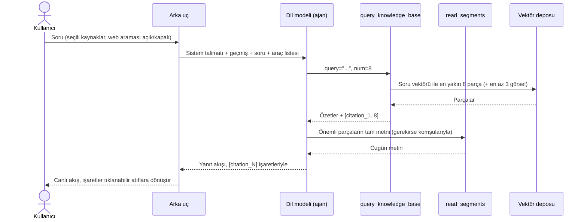

### 7.1 Ajanın araçları

| Araç | Ne yapar |
|---|---|
| `query_knowledge_base` | Anlamsal arama. Varsayılan **8** metin parçası ve **en az 3** görsel (sayının yarısı) döner. Sonuçlar **yalnızca özet** ve atıf numarası içerir. Ajan aramayı belirli dosyalarla sınırlayabilir |
| `read_segments` | Atıf numarası verilen parçaların **tam özgün metni**; tek parça için −7…+7 komşu parça da okunabilir |
| `ask_image` | Bir görsel hakkında görsel modeline soru sorar |
| `list_files`, `get_file_meta` | Kaynak listesi ve bilgileri |
| `web_search` | Web araması açıksa SearXNG üzerinden arama |
| `create_feature_generation` ve benzerleri | Sohbetten hızlı araç ya da kapsamlı rapor başlatma |

### 7.2 Kurallar ve sınırlar

| Kural | Değer |
|---|---|
| Arama kapsamı | Yalnızca o proje; kaynak seçiliyse yalnızca seçili kaynaklar |
| Sıralama | En yakından uzağa; **benzerlik eşiği ve yeniden sıralama (reranker) yok**, en iyi sonuçlar her zaman gider |
| Bir soruda araç turu | En çok **20**; son turda ajana "elindekiyle yanıtla" denir |
| Yanıt uzunluğu | En çok 8.192 token |
| Geçmiş | Son 40 mesaj; konuşma ~90.000 token'ı aşınca eski kısım özetlenerek sıkıştırılır |
| Tam metin okuma | Sistem talimatı önemli iddiaları, sayıları, adları ve alıntıları `read_segments` ile doğrulamayı ister; bu bir talimattır, zorunlu bir adım değildir |
| Bilgi yoksa | Model kaynaklarda bulamadığını söyler; uydurmaması istenir |

**Genel sohbet:** Hiç kaynak seçilmezse kaynak araçları kapanır; model yalnızca kendi bilgisiyle (ve açıksa web aramasıyla) yanıt verir.

**Durdurma:** Yanıt yarıda durdurulursa o ana kadarki metin "durduruldu" etiketiyle kaydedilir.

**Sohbet başlığı:** İlk sorudan sonra kısa bir başlık otomatik üretilir. Henüz adlandırılmamış sohbetler "Yeni sohbet" olarak görünür.

**Dışa aktarma:** Sohbetler Word belgesi olarak indirilebilir.

---

## 8. Atıflar: yanıttan paragrafa

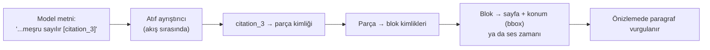

- Model numaraları `[citation_N]` biçiminde yazar; ayrıştırıcı bunları akış sırasında yakalar, aralıkları (`citation_2-4`) açar ve ekranda **1, 2, 3…** diye sıralı numaralara çevirir.
- Bir parça aynı yanıtta tekrar bulunursa aynı atıf numarasını korur; sohbet ilerledikçe numaralar kaldığı yerden devam eder, eski yanıtların atıfları bozulmaz.
- Atıf türleri: **parça** (sayfadaki paragraf), **görsel**, **ses** (zaman damgası) ve **web** (bağlantı, başlık, kısa alıntı).
- PDF'lerde vurgu özgün sayfa üzerinde, diğer biçimlerde ayrıştırılmış metin üzerinde gösterilir.

---

## 9. Hızlı araçlar, kapsamlı raporlar ve derin araştırma

### 9.1 Hızlı araçlar

Sağ paneldeki araçlar, sohbetle aynı ilkeyle çalışan ayrı bir ajan (**özellik ajanı**) tarafından üretilir: önce kaynaklarda arar, gerekirse tam metni okur, sonra çıktıyı aracın **katı biçim kurallarına** göre ve seçili çıktı dilinde yazar.

| Sekme | Araçlar |
|---|---|
| Öğrenme | Çalışma rehberi, Bilgi kartları, Sınav, SSS, Zihin haritası, Zaman çizelgesi |
| Analiz | İçerik özeti, Brifing belgesi, Podcast sohbeti, Sesli genel bakış, Karşılaştırmalı analiz, Özel hızlı araç |

Biçim kuralları sayesinde arayüz bazı çıktıları etkileşimli gösterir. Örneğin zihin haritası tek bir `#` merkez başlığı, 4–7 `##` ana dal ve atıflı madde işaretleri olarak istenir ve ağaç olarak çizilir. Zaman çizelgesi 8–20 adet `### tarih | başlık` girdisiyle istenir. Model kurala uymazsa çıktı düz belge olarak gösterilir. Her aracın "Ek gereksinimler" alanına yazdığınız talimat isteme eklenir.

| Kural | Değer |
|---|---|
| Araç turu | En çok 12 |
| Yanıt uzunluğu | En çok 8.192 token |
| Kuyrukta yeniden deneme | Yok (1 deneme; tekrar maliyet doğurmasın diye) |

### 9.2 Kapsamlı raporlar

Uzun, bölümlü raporlar iki aşamada üretilir: önce bir **planlayıcı** rapor başlığını ve bölüm planını çıkarır, sonra her bölüm özellik ajanı tarafından kendi kaynak aramasıyla ve atıflı olarak yazılır. Bölümler önceki bölümlerin sonuçlarına başvurabilir. Raporlar Word olarak dışa aktarılabilir.

### 9.3 Derin araştırma (web)

Kaynaklarınızın dışına çıkan, internetten atıflı rapor üreten bir iştir:

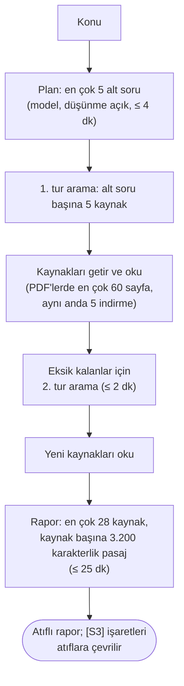

En az 300 karakter metni alınamayan kaynaklar elenir. Raporda yalnızca özetine erişilebilen kaynaklar ayrıca belirtilir.

---

## 10. Web ve akademik arama

Kaynak ekleme penceresindeki arama iki aşamalıdır; ilk sonuçlar modeli beklemeden gelir.

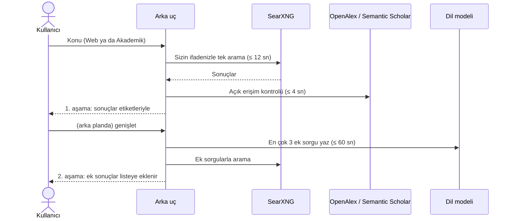

- **Akademik** kapsam SearXNG'nin bilim kategorisini kullanır.
- Her sonuç **Tam metin**, **Açık erişim** ya da **Yalnızca özet** olarak etiketlenir. DOI'si olan çalışmalar için ücretsiz PDF OpenAlex'te, bulunamazsa Semantic Scholar'da aranır; arXiv bağlantıları doğrudan PDF'e çevrilir.
- Seçtiğiniz sonuçlar kaynak olarak eklenir; ücretsiz PDF varsa PDF olarak indirilir ve [4](#4-kaynak-işleme-hattı)'teki hattan geçer.

---

## 11. Metin arama ve kaynak adlandırma

### 11.1 Metin arama

Kaynak panelindeki ve sonuç panelindeki arama, anlamsal değil **kelime** aramasıdır:

- Büyük-küçük harf, aksan ve kesme işaretleri yok sayılır: "maverdi" → "Mâverdî", "ibnul" → "İbnü'l".
- Arapçada harekeler yok sayılır; harekeli ve harekesiz yazım eşleşir.
- Bütün kelimeler geçmelidir (VE araması).
- Kaynaklarda dosya adında ve (isteğe bağlı) içerikte, sonuçlarda notlar, araç sonuçları ve rapor bölümlerinde arar; bulunan yer vurgulanmış kısa bir alıntıyla gösterilir.

### 11.2 Kaynak adlandırma

"Yazar - Yıl - Eser" önerisi için dosya adı ve ilk sayfalar modele gönderilir. Model başlık sayfası ve künyeden yazarı (çevirilerde özgün yazarı), bu baskının yılını (hicri/miladi çift yıl korunur; yoksa boş bırakılır, tahmin edilmez) ve alt başlıksız eser adını çıkarır, bir güven düzeyi verir.

| Kural | Değer |
|---|---|
| Model | Kolay görevler modeli (tanımlıysa), yoksa ana model |
| Düşünme | Açık (transliterasyon ve yıl seçimi yargı gerektirir) |
| Süre sınırı | 150 saniye; aşılırsa öneri boş kalır, kaynak etkilenmez |

---

## 12. Ayarlar ve modeller

Çalışma zamanı ayarları SQLite'taki `settings` tablosunda durur ve Ayarlar sayfasından değiştirilir; yeniden başlatma gerekmez. Bir ayar okunurken önce veritabanındaki değere, yoksa aynı adlı ortam değişkenine, o da yoksa varsayılana bakılır.

| Ayarlar sekmesi | İçerik |
|---|---|
| Genel bakış | Bütün yapılandırmanın özeti |
| Model ayarları | Ana LLM (adres, model, API anahtarı, istek biçimi: OpenAI uyumlu ya da Anthropic), kolay görevler için ayrı bir model (isteğe bağlı; ana modelin anahtarını kullanır), görsel modeli (VLM) |
| Gömme | Yerel bge-m3 ya da OpenAI uyumlu API; bağlantı testi; yeniden vektörleme |
| PDF ayrıştırma | Otomatik / Yerel / OCR; OCR servisi |
| Ses | FunASR (yazıya dökme), TTS (seslendirme) |
| Web arama | SearXNG adresi |
| Sistem durumu | Model kullanımı, yedekleme, tanılama (yalnızca yönetici) |

**Düşünme (reasoning) kipi:** Bazı modeller yanıtlamadan önce uzun süre "düşünür". Kısa ve kesin yanıt gereken işlerde (ör. ek arama sorguları) düşünme kapatılarak istenir; sunucu bunu reddederse düşünme açık olarak bir kez daha denenir. Yargı gerektiren işlerde (kaynak adlandırma, derin araştırma planı ve raporu) düşünme açık bırakılır.

---

## 13. Kullanıcılar, güvenlik ve yönetim

### 13.1 Kullanıcılar ve oturum

- İki rol vardır: **yönetici** ve **normal kullanıcı**. Kullanıcı yönetimi ve Ayarlar yalnızca yöneticiye açıktır.
- Giriş JWT ile yapılır (HS256); oturum varsayılan olarak **7 gün** geçerlidir (`ACCESS_TOKEN_EXPIRE_MINUTES`).
- Her kullanıcı yalnızca kendi projelerini görür.

### 13.2 Güvenlik varsayımları

- Uygulama **tek bilgisayar ya da güvenilen yerel ağ** için tasarlanmıştır; internete açılmamalıdır.
- CORS yalnızca `localhost` ve özel yerel ağ adreslerini, arayüz portunda ve 5173'te kabul eder (`CORS_ALLOW_PORTS` ile genişletilebilir).
- API anahtarları veritabanında **düz metin** durur; veri klasörünü koruyun (macOS'ta FileVault).
- Bulut LLM kullanıldığında soru ve ilgili parçalar o sağlayıcıya gönderilir. Ayrıntılar: [SECURITY.md](../SECURITY.md).

### 13.3 Kullanıcı yönetimi ve istatistikler

<p align="center">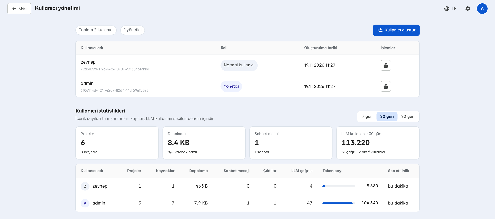</p>

Kullanıcı başına proje, kaynak (hazır/toplam), depolama, sohbet mesajı, çıktı sayısı, son 7/30/90 gündeki LLM çağrısı ve token payı ile son etkinlik gösterilir. İçerik sayıları tüm zamanları, LLM kullanımı seçilen dönemi kapsar.

### 13.4 Sistem durumu

<p align="center">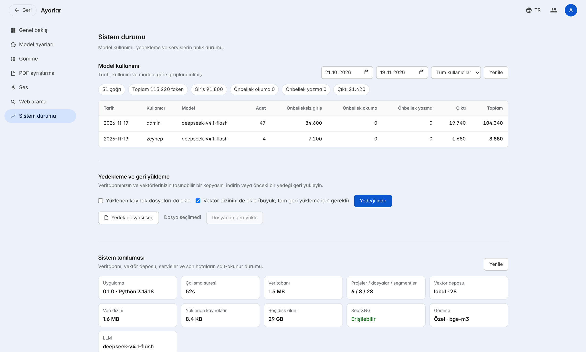</p>

**Model kullanımı.** Her başarılı LLM çağrısının token'ları gün × kullanıcı × model başına toplanır: önbelleksiz giriş, önbellekten okuma, önbelleğe yazma ve çıktı. Gün, bilgisayarın saat dilimine göre belirlenir (`USAGE_TIMEZONE` ile değiştirilebilir).

**Yedekleme ve geri yükleme.**

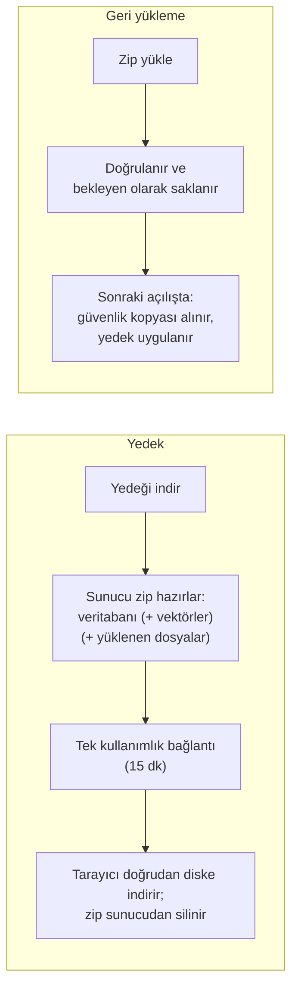

- Geri yüklemeden önce alınan güvenlik kopyalarının en yeni **3**'ü tutulur (`BACKUP_KEEP_PRE_RESTORE`).
- İndirilmeyen yedekler bağlantı süresi dolunca, yerine yenisi yüklenen geri yükleme dosyaları hemen silinir.
- Vektörler yedeğe eklenmezse, geri yüklemeden sonra kaynakların yeniden vektörlenmesi gerekir.

**Tanılama.** Uygulama sürümü, çalışma süresi, veritabanı boyutu (WAL dosyası dahil), proje/dosya/parça sayıları, vektör sayısı, veri ve yükleme klasörü boyutu, boş disk alanı (10 GB'ın altında kırmızı), SearXNG erişimi, yerel gömme servisinin canlı `/health` yanıtı (model ve boyut) ve günlükteki son uyarı/hatalar. Milvus Lite'ın zararsız `AllocTimestamp` hatası süzülür.

---

## 14. Hatalar, yeniden denemeler ve kurtarma

| Nerede | Ne olur | Deneme |
|---|---|---|
| Gömme isteği | 408, 425, 429, 5xx ve bağlantı hatalarında artan beklemeyle yeniden dener (en çok 10 sn ara); yerel servis kapalıysa bir kez başlatır; 400 gibi kalıcı hatalarda hemen durur | 3 (`EMBED_MAX_ATTEMPTS`) |
| Parça özeti | Geçici hatalarda yeniden dener; olmazsa alıntıya düşer | 5 |
| Dosya / proje özeti | Hatayı belirten istemle yeniden dener; olmazsa yedek özet | 3 |
| Ayrıştırma görevi | İçerik kaydedilmeden önceki hatada görev yeniden denenir; kaydedildikten sonraki hatada yalnızca vektörleme yeniden kuyruğa alınır | 3 |
| Yeniden vektörleme | Kısa bir Milvus/veritabanı aksaklığı için | 2 |
| Proje özeti yenileme | Geçici sağlayıcı hatası için | 2 |
| Hızlı araç, derin araştırma, kapsamlı rapor | Yeniden denenmez (maliyet ve yinelenen içerik riski) | 1 |
| Kaynak adlandırma | 150 sn içinde yanıt yoksa öneri boş kalır | 1 |
| Web araması ek sorguları | 60 sn içinde yanıt yoksa yalnızca 1. aşama sonuçları kalır | 1 |
| Arka uç yeniden başlatma | "İşleniyor"da takılı kaynaklar açılışta yeniden kuyruğa alınır | — |

**Günlükteki uyarıları okumak:**

| Uyarı | Anlamı | Sonuca etkisi |
|---|---|---|
| `segment N summary failed, using snippet fallback` | O parçanın özeti yazılamadı, alıntı kullanıldı | Arama etkilenmez; özet kalitesi o parça için düşer |
| `model call timed out after 150s (thinking default)` + `no answer within 150s` | Kaynak adlandırma isteği zaman aşımına uğradı | Yalnızca o kaynağın ad önerisi boş kalır |
| `web discovery query expansion timed out` | Ek arama sorguları yazılamadı | Yalnızca ilk aşama sonuçları gösterilir |
| `open access annotation timed out` | Açık erişim kontrolü süreye sığmadı | Sonuçlar etiketsiz gösterilir |

---

## 15. Bilinen sınırlar

- **Parça özetleri örnekleme dayanır.** 200 parçadan uzun kaynaklarda parçaların çoğunda özet yerine parçanın başından alıntı durur. Arama bundan etkilenmez, ama modelin arama sonucunda ilk gördüğü metin bu alıntıdır.
- **Dosya özeti 20 parçaya dayanır.** Çok uzun bir kitabın genel özeti kitabın tamamını değil, ondan alınmış bir örneklemi yansıtır.
- **Tam metin okuma modele bırakılmıştır.** Ajan `read_segments` çağırmadan yalnızca özetlerle yanıt yazabilir; talimat bunu önermez ama engellemez.
- **Eşik ve yeniden sıralama yoktur.** Her aramada en yakın 8 parça, benzerlikleri düşük olsa bile modele gider; model alakasız olanları ayıklamak zorundadır.
- **Gömme API'lerinde normalizasyon sağlayıcıya bağlıdır.** Yerel bge-m3 normalize eder; bir API normalize etmiyorsa L2 sıralaması kosinüsten biraz farklı olabilir.
- **API anahtarları düz metin saklanır** ve uygulama internete açık kullanım için sertleştirilmemiştir.
- **Çıktıların doğruluğu modele bağlıdır.** Atıflar kaynağa bağlanır ama modelin bir parçayı yanlış yorumlamadığını garanti etmez; önemli iddiaları atıfa tıklayarak kontrol edin.

---

## 16. Sözlük

| Terim | Anlamı |
|---|---|
| **Ajan** | Yanıt yazmadan önce araçları (arama, okuma) kendisi çağıran dil modeli |
| **Atıf** | Yanıttaki bir iddiayı dayandığı parçaya bağlayan numara |
| **Blok** | Belgenin en küçük öğesi (paragraf, başlık, tablo, görsel) ve sayfadaki konumu |
| **Çıktı dili** | Özetlerin ve araç çıktılarının yazıldığı dil; arayüz dilinden bağımsız seçilebilir |
| **Gömme (embedding)** | Metnin anlamını temsil eden sayı dizisi (vektör) ve bunu üreten model |
| **IVF** | Vektörleri kümelere ayırıp yalnızca en yakın kümelerde arayan hızlı indeks türü |
| **Kolay görevler modeli** | Başlık, adlandırma gibi kısa işler için tanımlanabilen ikinci, daha hızlı/ucuz model |
| **L2 / kosinüs** | İki vektörün yakınlığını ölçme yolları; normalize vektörlerde aynı sıralamayı verirler |
| **Parça (segment)** | 200–400 karakterlik arama birimi |
| **RAG** | Yanıtı, o an kaynaklardan getirilen parçalara dayandırarak üretme yöntemi |
| **SearXNG** | Birden çok arama motorunu tek yerden sorgulayan, yerelde çalışan arama servisi |
| **SSE** | Yanıtın sunucudan tarayıcıya parça parça (canlı) aktarılması |
| **Token** | Modellerin metni ölçtüğü birim; kabaca bir kelimenin parçası |
| **VLM** | Görsel ve metni birlikte anlayan model (görsel açıklama, `ask_image`) |
| **WAL** | SQLite'ın yazmaları önce ayrı bir günlüğe kaydettiği, daha dayanıklı çalışma kipi |
